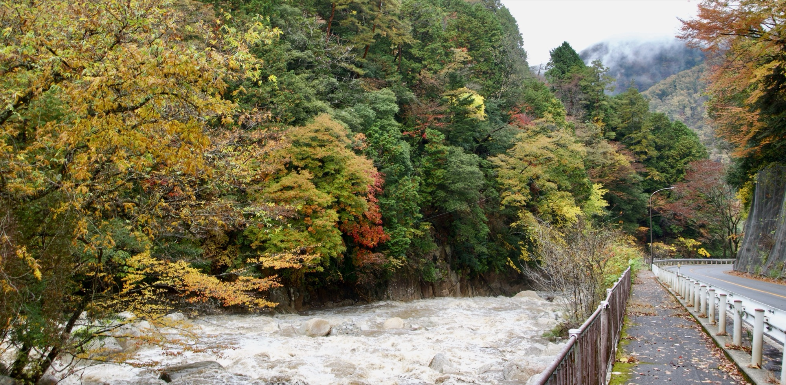
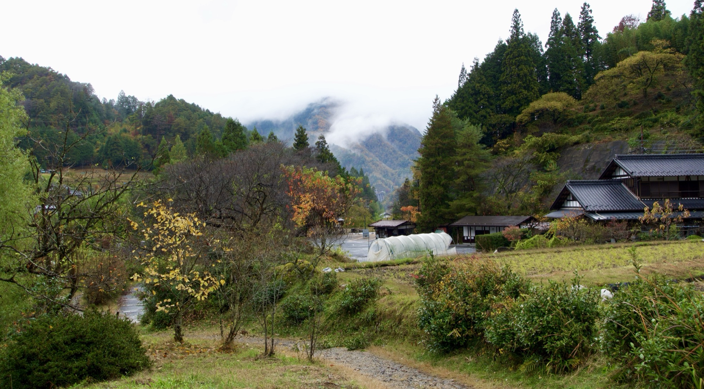
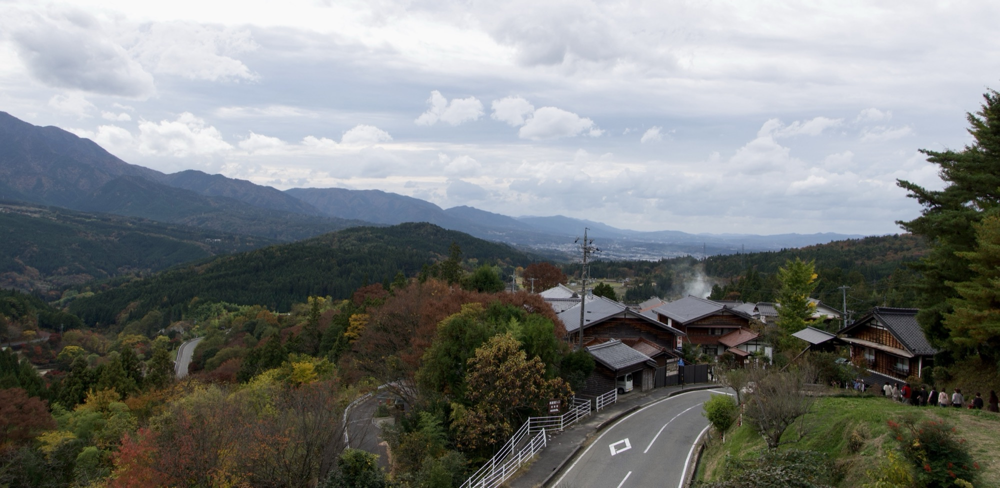

Kiso Valley, Gifu and Nagano Prefectures, Japan



Sections of the Nakasendo Way, November 2023.

The tiny postal towns of Magome (馬籠宿) and Tsumago (妻籠宿) are the best-known stops along the Nakasendo Way (中山道), a historic route stretching over 500 kilometers from Tokyo to Kyoto.[^1] In 1600s Tokugawa-era Japan, feudal lords were required by the Shogunate to make periodic journeys between their domains and Edo, now modern-day Tokyo. This practice fueled Edo's urban expansion and spurred the development of pre-industrial transportation, communications, and credit networks. In addition to Magome and Tsumago, other Kiso Valley spots like Narai (奈良井宿) and the city of Ena (恵那市) also maintain historic buildings from this era.

```{r trail-route}
#| fig-cap: "Magome, Tsumago, and around: south to Nagoya, north to Matsumoto."
#| echo: false
#| warning: false
#| message: false

library(leaflet)
library(dplyr)

all_towns <- data.frame(
    name = c(
        "Nagoya (名古屋市)",
        "Nakatsugawa (中津川市)",
        "Magome (馬籠宿)",
        "Tsumago (妻籠宿)",
        "Nagiso (南木曽町)",
        "Narai (奈良井宿)",
        "Matsumoto (松本市)"
    ),
    lat = c(
        35.170967032540716,
        35.50051568303099,
        35.52614113801339,
        35.57772800281878,
        35.598982563309995,
        35.96849070482742,
        36.23082106754404
    ),
    long = c(
        136.88084668069683,
        137.50309415758724,
        137.5659264477835,
        137.59565749661266,
        137.60840626083387,
        137.8144945809696,
        137.96441628261374
    )
)

# render with leaflet
leaflet::leaflet() |>
    leaflet::addTiles() |>
    leaflet::addMarkers(
        lng = all_towns$lon,
        lat = all_towns$lat,
        popup = all_towns$name
    )

```

## Tokugawa-era Nakasendo

### The Five Highways

The Nakasendo (中山道, literally "central mountain route"), also called the Kisokaido (木曾街道), ran from the Shogunate's military-political capital of Edo to the imperial capital of Kyoto. It was one of the Gokaido (五街道)，five centrally-administered routes fanning out from Edo. Tabulations made in the 1820s show the Tokaido was the most heavily traveled route, then the Oshu Kaido and the Nakasendo.[^2]

, via Wikimedia Commons.](assets/gokaido-edo-five-routes-map.png){width=500 fig-alt="Map of the five Edo-period routes across Japan"}

|  Route  | Final Point | Rough Distance | Postal Stations | Terrain |
| ------- | ----------------- | ------------ | ---------------- | --------------- |
| Nakasendo (Kisokaido) | Kyoto | ~534 km / 332 mi | 69 stations | Mountainous inland path through central Honshu |
| Tokaido | Kyoto | ~514 km / 319 mi | 53 stations | Southern coastal lowland path |
| Koshu Kaido | Shimosuwa-shuku, linking to Nakasendo via Kai Province | ~210 km / 130 mi | 44 stations | Hilly route through Kanto plain into the Kai Basin | 
| Oshu Kaido | Shirakawa, Mutsu Province | ~185 km / 115 mi | 27 stations (first 17 shared with Nikko Kaido) | Northbound plain and low hills | 
| Nikko Kaido | Nikko Tosho-gu, Shimotsuke Province | ~146 km / 91 mi | 21 stations (first 17 shared with Oshu Kaido) | Flat northbound plain route | 

These highways are depicted in some of the most iconic woodblock prints of the time. The 53 postal stations of the Tokaido were memorialized in a series by famed woodblock artist, Utagawa Hiroshige, seen in an exhibition at the [Shizuoka City Tokaido Hiroshige Museum of Art](https://tokaido-hiroshige.jp/en/exhibition/2024/fifty-three_stations.html) showing horses, soldiers, porters, servants, and nobles. Hiroshige also partnered with Keisai Eisen and other artists for a woodblock series depicting the Nakasendo's 69 postal stations. The [Nakasendo Hiroshige Museum of Art](https://hiroshige-ena.jp/english/) in Ena City has posted [a helpful guide](https://www.youtube.com/watch?v=LrUvYMylVl4) to their collection of these prints (turn on English subtitles for translation). 

### Alternate Attendance as Political Control

The year is 1600. Tokugawa Ieyasu achieves a decisive victory at the Battle of Sekigahara, establishing himself as the supreme military commander, or Shogun, after decades of civil war between feudal clans.[^3] He forms his government in a small fishing village, Edo, renamed Tokyo in 1868.[^4] His family will govern Japan without major political crises for more than 250 years.[^5] Now, though, he must consolidate his authority over a fractured country.

Mandated in 1635 to prevent rebellion, alternate attendance, or sankin-kotai (参勤交代), helped cement the Tokugawa Shogunate's territorial control.[^6] The Tokugawa Shogunate was concurrently pushing through other dramatic changes, including sakoku ("locked country," a near-ban on foreign entry and trade that stemmed the outflow of silver to China) and the required construction and refurbishment of domain castle-towns.[^7] Under alternate attendance, every two years, the Shogunate expected feudal lords, or daimyo, to journey from their domains to spend a year in residence in Edo, where their wives and children lived as effective hostages to guarantee their loyalty.[^8] Owing to alternate attendance and the construction of domainal residences in Edo, the city grew to one of the world's largest urban areas of its time, boasting a population of a million or more by the early 1700s.[^9] Its size led to its moniker of Toto, eastern capital, in contrast with Japan's western capital of Kyoto.[^10]

On a political level, sustaining this practice was a heavy tax on feudal daimyo, who might otherwise amass resources in their domains. The practice occupied much of their time, as daimyo might spend much of their adult lives either in residence at or traveling to and from Edo. The journey could also be lengthy for daimyo of far-flung domains. If setting out from the distant domain of Tosa on the island of Shikoku, it took 3-4 weeks of travel to arrive in Edo.[^11] Moreover, daimyo were expected to travel in a style befitting their status. Historian Constantine Vaporis explains that depending on a domain's distance from Edo, travel costs could equal 5 to 20 percent of its budget. Adding the hefty expense of supporting a domain's Edo residence and staff, total outlays could consume between half and three-quarters of a domain's disposable income.[^12] 

This system shaped the Tokugawa-era economy in notable ways. Over time, these increased expenses and Japan's economic isolation prompted import substitution and domain-assisted specialization in regional markets. The domains' fiscal base was officially founded on taxes paid in rice, which were regularly shipped to domains' warehouses in Osaka and sold to merchant houses.[^13] However, not all domains were suited to rice cultivation. The more successful domains invested resources to encourage the production and regional trade in high-quality local specialities, including subsidies, technique development, and quality control. Economic historian Penelope Francks details the cultivation of indigo in Tokushima and paper in Tosa, which those daimyo carried with them as promotional advertisements to gift along their travels.[^14] From an economic perspective, alternate attendance spurred the development of the Gokaido, five long-distance highways fanning out from Edo, leading to networks of nearby inns, tea houses, and postal stations to serve as way-stations en route. As a practical matter, increased official travel also required longer-ranging logistics and communications networks, even forms of payment on credit from merchant moneylenders. 

::: {.callout-note title="Breaking the Monopoly of the Osaka Wholesalers"}
Osaka wholesalers' monopoly power is a theme that carries through Francks' description of this period. The Tokugawa era's economic isolation and rapid urbanization elevated Osaka's role as a merchant base and supplier to Edo. Osaka served as a trading hub for tax rice (calculated based on land surveys and typically paid in kind), as well as processed goods like soy sauce and sake, and manufactured products like clothing and ceramics. Consequently, its merchant houses developed commercial and financial expertise in managing regional trade in these goods. Though they received authorization from the Shogun, their monopoly arose in large part because they could offer producers and merchants credit against future purchases.[^15] One positive result of expanding regional commerce: the declining severity of food shortages and famines that had characterized medieval Japan. 

However, the Osaka wholesalers' monopoly and price-setting power were not necessarily welcomed by the regional daimyo, who sought to bypass Osaka and carve out profits for themselves. In her study, Francks discusses various daimyo tactics including: 

* a Tokushima domain-run agency that reserved for itself the middleman power of selling indigo to the wholesalers (a short-lived move protested by local merchants);  
* the Tokushima establishment of free but centralized trade in indigo within the domain, with local taxes on sales (taken to court by the wholesalers);  
* a Tosa domain-run licensed monopoly on paper sales above the domain's allotted quota (another short-lived experiment that met local resistance);  
* Tosa's ultimate abandonment of its quota system, replaced by more profitable sales and "export" taxes on paper.

:::

### Recommended reading

The summary above is based on the excellent work of:  

| Author | Title | Year | Description |
| ------ | ----- | ---- | ----------- |
| Penelope Francks | [_Japanese Economic Development: Theory and Practice, 3rd Edition_](https://www.goodreads.com/book/show/26121343-japanese-economic-development) | 2015 | Fascinating history of Japan's economic development from the Tokugawa era until World War II. |
| Takatoshi Ito and Takeo Hoshi | [_The Japanese Economy, 2nd Edition_](https://mitpress.mit.edu/9780262357180/the-japanese-economy/) | 2020 | Seminal text on Japan's economy, with a focus on postwar development. |
| Constantine Vaporis | [_Tour of Duty: Samurai, Military Service in Edo, and the Culture of Early Modern Japan_](https://uhpress.hawaii.edu/title/tour-of-duty-samurai-military-service-in-edo-and-the-culture-of-early-modern-japan/) | 2009 | The textbook history on the practice of alternate attendance. | 
| Toshio G. Tsukahira | [_Feudal Control in Tokugawa Japan: the Sankin Kotai System_](https://archive.org/details/feudalcontrolint0000tsuk/mode/2up) | 1966 | Excellent monograph detailing alternate attendance and its economic effect on the daimyo. |



## Trip planning!

The tiny Kiso Valley towns of Magome, Tsumago, and others nearby like Narai and Ena are well-preserved postal towns along the Nakasendo Way. They see a variety of visitors, from international tourists to local schoolchildren on field trips. The towns have restored the wooden buildings as a way to preserve local history. The distance between Magome and Tsumago in particular is short enough to make it a pleasant walk of a few hours (roughly 8km), and there are plenty of small shops to peruse. 

General travel notes: 

- Reserve any lodging **well in advance,** as much as six months or more. Local inns book out quickly, especially in small towns like Magome and Tsumago. 
- If you're not comfortable with Japanese, download the Google Translate Japanese language pack (or similar) for offline translation. 
- Bring cash for your travel and stay, including small bills for food and transportation. As of writing, Japan is still highly cash-dominant, especially outside major cities. 
- Review local bus and train schedules to plan your time. Transportation can be quite sparse. 
- If you don't have a local mobile/data plan, purchase an e-sim or local simcard for communications. You may find simcard kiosks in larger train stations like Nagoya. 

Magome and Tsumago travel notes: 

The path between Magome and Tsumago is likely the best-known portion of the Nakasendo Way and quite lovely. While you could try traveling there and back in a single day, your timing would be very tight and I wouldn't advise it unless you have your own transport. Instead, if you have a few months ahead to plan, consider staying at one of the traditional inns along the trail. The [Nagiso Tourism Office](https://en.nagiso.jp/topics_category/stay/) has a helpful list of accommodation. Personally, I highly recommend our lodging, [Minshuku Koshinzuka](https://sites.google.com/view/kooshinzuka/english), whose proprietor grilled fish on his hearth for our dinner. Our room overlooked the stream running behind the minshuku, entirely charming; you'd be hard-pressed to do better.  

Magome and Tsumago are accessible by train from Nagoya to the south and from Nagano or Matsumoto to the north. 

- From Nagoya (south): take a train to [Nakatsugawa](https://maps.app.goo.gl/o4EReYGqNbbyS75n8) and then take a [local bus](https://www.japan-guide.com/bus/kiso.html) to [Magome](https://maps.app.goo.gl/adbFoU8Q1qVLQm768).
- From Nagano or Matsumoto (north): take a train to [Nagiso](https://maps.app.goo.gl/VioiNZndganTLFAbA), then either wait for a bus or walk to [Tsumago](https://maps.app.goo.gl/DRTxMpPnW7R6WxPH6). The walk follows the Kiso River and is quite pretty; highly recommend if time allows.

Matsumoto travel notes:

After exploring the Nakasendo Way, we traveled north to the small city of Matsumoto in Nagano Prefecture. Highly recommend! Matsumoto Castle is very impressive, and we were given a fabulous tour by our intrepid Alps Language Service Association guide. 

- Visit [Matsumoto Castle](https://www.matsumoto-castle.jp/eng/about)!
  - The castle [was preserved by local residents](https://www.youtube.com/watch?v=n464VoX1zeE) despite being slated for demolition during the Meiji Restoration. 
  - Contact the wonderful and wonderfully-informative ["Alps Language Service Association"](https://www.npo-alsa.com/home-en) to request an English-language tour of the castle. Their dedicated, knowledgeable volunteers give an in-depth introduction to the castle and city overall. 
- The [Matsumoto City Museum of Art](https://matsumoto-artmuse.jp/en/) is also quite interesting. It features the work of internationally-acclaimed artist [Yayoi Kusama](https://yayoi-kusama.jp/en/), of [polka-dot fame](https://www.otafinearts.com/artists/72-yayoi-kusama/). 

### Planning inspiration

| Blog or Site | Written/Updated | Post or Article | 
| ------------ | --------------- | --------------- |
| Maris Around the World | Summer 2021 | ["Solo Hiking the Nakasendo Trail"](https://www.marisaroundtheworld.com/solo-hiking-the-nakasendo-trail-complete-guide-and-itinerary/) |
| Todd Fong | Spring 2026 | ["Follow the Edo Shogun Roads to Japan's Samurai Era"](https://toddfong.com/follow-the-edo-shogun-roads-to-japans-samurai-era/) |
| Ridgeline Images | Spring 2026 | ["The Nakasendo Kiso Valley: A Complete 5-Day Walking Guide"](https://ridgelineimages.com/hiking/nakasendo-kiso-valley-a-complete-5-day-walking-guide/) | 
| Japan-Guide.com | Fall 2024 | ["Magome-Tsumago Trail"](https://www.japan-guide.com/e/e6078.html) and ["Kiso Valley: Getting there and around"](https://www.japan-guide.com/e/e6079.html) | 
| Matt Evans, Japan-Guide.com | Winter 2024 | ["Ena City: A Rural Gem on the Historic Nakasendo"](https://www.japan-guide.com/ad/ena/) | 
| Nagiso Tourism Association | unclear | ["See"](https://en.nagiso.jp/topics_category/see/) and ["Stay"](https://en.nagiso.jp/topics_category/stay/) |
| Japan National Tourism Organization | unclear | ["Magome (Nakasendo)"](https://www.japan.travel/en/spot/1271/), ["Tsumago (Nakasendo)"](https://www.japan.travel/en/spot/1365/), and ["Kiso Valley"](https://www.japan.travel/en/destinations/hokuriku-shinetsu/nagano/kiso/) | 
| Travel with Kat | before 2020 | ["In the Footsteps of the Samurai: Walking the Nakasendo Way"](https://travelwithkat.com/walking-the-nakasendo-way/) | 
| Travely Notes | Spring 2025 | ["A Hiking Guide to the Magome-Tsumago Nakasendo Trail"](https://www.travelynotes.com/blog-japan/a-hiking-guide-to-the-magome-tsumago-nakasendo-trail) | 



[^1]: Kiso Ontake Tourism Office, ["Ancient Nakasendo Trail."](https://en.visitkiso.com/nakasendo)
[^2]: Toshio G. Tsukahira, *Feudal Control in Tokugawa Japan: The Sankin Kotai System* (East Asian Research Center, Harvard University, Cambridge, MA: 1966): 70-71.
[^3]: Penelope Francks, *Japanese Economic Development: Theory and Practice, 3rd ed.* (Routledge, New York, NY: 2015): 21.
[^4]: Takatoshi Ito and Takeo Hoshi, *The Japanese Economy, 2nd Ed.* (MIT Press, Cambridge, MA: 2020): 6-7.
[^5]: Takatoshi Ito and Takeo Hoshi, *The Japanese Economy, 2nd Ed.* (MIT Press, Cambridge, MA: 2020): 6-7.
[^6]: Constantine Vaporis, *Tour of Duty: Samurai, Military Service in Edo, and the Culture of Early Modern Japan* (University of Hawai'i Press, Honolulu, Hawai'i: 2008): 9; Penelope Francks, *Japanese Economic Development: Theory and Practice, 3rd ed.* (Routledge, New York, NY: 2015): 24.
[^7]: Penelope Francks, *Japanese Economic Development: Theory and Practice, 3rd ed.* (Routledge, New York, NY: 2015): 22-24.
[^8]: Penelope Francks, *Japanese Economic Development: Theory and Practice, 3rd ed.* (Routledge, New York, NY: 2015): 24-25.
[^9]: Penelope Francks, *Japanese Economic Development: Theory and Practice, 3rd ed.* (Routledge, New York, NY: 2015): 30.
[^10]: Constantine Vaporis, *Tour of Duty: Samurai, Military Service in Edo, and the Culture of Early Modern Japan* (University of Hawai'i Press, Honolulu, Hawai'i: 2008): 128.
[^11]: Constantine Vaporis, *Tour of Duty: Samurai, Military Service in Edo, and the Culture of Early Modern Japan* (University of Hawai'i Press, Honolulu, Hawai'i: 2008): 36.
[^12]: Constantine Vaporis, *Tour of Duty: Samurai, Military Service in Edo, and the Culture of Early Modern Japan* (University of Hawai'i Press, Honolulu, Hawai'i: 2008): 27.
[^13]: Toshio G. Tsukahira, *Feudal Control in Tokugawa Japan: The Sankin Kotai System* (East Asian Research Center, Harvard University, Cambridge, MA: 1966): 83-84.
[^14]: Penelope Francks, *Japanese Economic Development: Theory and Practice, 3rd ed.* (Routledge, New York, NY: 2015): 35-39.
[^15]: Penelope Francks, *Japanese Economic Development: Theory and Practice, 3rd ed.* (Routledge, New York, NY: 2015): 36.